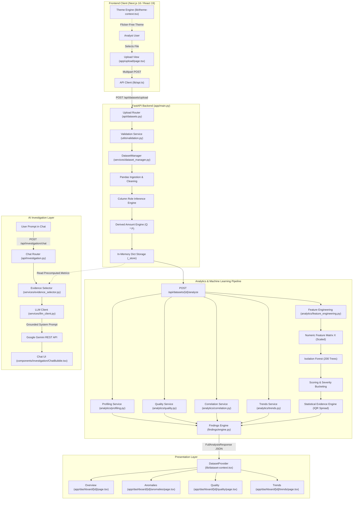

# AI Data Anomaly Detection & Investigation Copilot
## Comprehensive Architectural Audit, Engineering Blueprint & Viva Defense Guide

---

## Executive Summary

This document provides an exhaustive, student-friendly architectural audit, engineering breakdown, and viva examination defense guide for the **AI Data Anomaly Detection & Investigation Copilot**. 

It is designed for B.Tech Computer Science and Engineering (CSE) academic evaluations, technical pair-programming, and real-world system audits. It reflects the exact state of the codebase, detailing what is implemented, what is simulated, mathematical foundations, data pipelines, potential bottlenecks, and security considerations.

---

## Table of Contents
1. [Project Inventory & Component Status](#1-project-inventory--component-status)
2. [End-to-End System Journey: A Practical Example](#2-end-to-end-system-journey-a-practical-example)
3. [Problem Statement & Domain Analysis](#3-problem-statement--domain-analysis)
4. [System Architecture & Data Flow (Mermaid Diagram)](#4-system-architecture--data-flow)
5. [Frontend Engineering (Next.js 16 / React 19)](#5-frontend-engineering)
6. [Backend Engineering (FastAPI)](#6-backend-engineering)
7. [Anomaly Detection Engine (Mathematical & Algorithmic Foundations)](#7-anomaly-detection-engine)
8. [Feature Engineering Pipeline](#8-feature-engineering-pipeline)
9. [Data Quality vs. Business Anomaly Taxonomy](#9-data-quality-vs-business-anomaly-taxonomy)
10. [Dashboard Metrics & Visualizations](#10-dashboard-metrics--visualizations)
11. [Anomaly Investigation & Evidence Generation](#11-anomaly-investigation--evidence-generation)
12. [AI Investigation Copilot (LLM Architecture & Guardrails)](#12-ai-investigation-copilot)
13. [Sample Dataset Audit & Scalability Limits](#13-sample-dataset-audit--scalability-limits)
14. [Real-World Enterprise Applicability](#14-real-world-enterprise-applicability)
15. [Model Evaluation Without Labels](#15-model-evaluation-without-labels)
16. [Testing & Quality Assurance Audit](#16-testing--quality-assurance-audit)
17. [Security & Vulnerability Assessment](#17-security--vulnerability-assessment)
18. [Performance Profiling & Bottlenecks](#18-performance-profiling--bottlenecks)
19. [GitHub Pre-Flight Checklist](#19-github-pre-flight-checklist)
20. [Deployment Readiness & Roadmap](#20-deployment-readiness--roadmap)
21. [Prioritized Improvement Roadmap](#21-prioritized-improvement-roadmap)
22. [Viva Voce & Technical Interview Defense Guide](#22-viva-voce--technical-interview-defense-guide)
23. [Core Project Summary](#23-core-project-summary)

---

## 1. Project Inventory & Component Status

The codebase is partitioned into a FastAPI Python backend and a Next.js TypeScript frontend.

```
AI-Data-Anomaly-Detection/
├── backend/
│   ├── app/
│   │   ├── analytics/           # Profiling, data quality, correlations, trends, feature engineering
│   │   ├── anomaly/             # Isolation Forest detector & statistical evidence generator
│   │   ├── api/                 # FastAPI routers (datasets, analysis, findings, investigation)
│   │   ├── findings/            # Deterministic multi-dimensional findings engine
│   │   ├── models/              # Pydantic data contracts and schemas
│   │   ├── services/            # In-memory DatasetManager, evidence selector, Gemini LLM client
│   │   └── utils/               # Validation rules (file size, extension, row bounds)
│   ├── data/sample/             # Retail transaction CSV sample (489 rows, injected outliers)
│   ├── tests/                   # Pytest test suite (20 automated tests)
│   ├── .env                     # Local configuration (Contains GEMINI_API_KEY)
│   └── requirements.txt         # Python dependencies
├── frontend/
│   ├── app/                     # Next.js 16 App Router pages
│   ├── components/              # UI components, Recharts visualizations, chat interface
│   ├── lib/                     # API client, Dataset context, React 19 theme engine
│   └── package.json             # NPM dependencies (React 19, Tailwind v4, Recharts 3.10)
└── docs/                        # Project documentation
```

### Component Status Table

| Subsystem | Implemented Files | Implementation Status | Notes |
| :--- | :--- | :--- | :--- |
| **Frontend UI** | Next.js 16, React 19, Tailwind CSS v4, Recharts, Lucide Icons | **PRESENT** | Complete dashboard with dark/light mode toggle. |
| **Backend API** | FastAPI, Uvicorn, Pydantic v2 | **PRESENT** | High-performance asynchronous REST endpoints. |
| **ML Engine** | Scikit-Learn `IsolationForest` | **PRESENT** | 200 trees, `contamination="auto"`, StandardScaler. |
| **Analytics Engine** | Pandas & NumPy statistical routines | **PRESENT** | Profiling, correlations, time trends, data quality. |
| **AI Investigation** | Google Gemini REST client | **PRESENT** | Evidence-grounded system prompts with multi-model failover. |
| **Database / Storage** | Python in-memory dictionary | **PARTIALLY IMPLEMENTED** | Datasets reside in RAM only; lost upon server restart. |
| **Authentication** | *None* | **MISSING** | No user sessions, passwords, or token validation. |
| **Automated Tests** | Pytest (20 backend test cases) | **PARTIALLY IMPLEMENTED** | Backend covered; frontend has no automated tests. |
| **Containerization** | *None* | **MISSING** | No Dockerfile or docker-compose configurations. |
| **Git Configuration** | `backend/.gitignore`, `frontend/.gitignore` | **PARTIALLY IMPLEMENTED** | Root `.gitignore` is missing. |

---

## 2. End-to-End System Journey: A Practical Example

Consider an e-commerce retailer, **Metro Retail Ltd.**, auditing weekly transactions. An analyst uploads `transactions_sample.csv` to identify irregular purchases.

```
[1. Browser Client] ───────── Drag-and-drop CSV ─────────> [2. Upload View]
                                                                  │
[4. Column Role Inference] <── Multipart POST /upload ────── [3. lib/api.ts]
         │
         ├──> Identify quantity, unit_price
         └──> Derive amount = quantity * unit_price (if missing)
         │
         ▼
[5. Feature Engineering] ─── Build Numeric Matrix X (Impute & Scale)
         │
         ▼
[6. Isolation Forest] ───── Fit 200 Isolation Trees -> Generate Scores & Severities
         │
         ▼
[7. Findings Engine] ────── Merge Data Quality, Outliers, Correlations, Trends
         │
         ▼
[8. React Context] ──────── Client Receives FullAnalysisResponse JSON
         │
         ├──> Render KPI Cards, Trends Chart, Severity Distribution
         └──> User Clicks "Investigate with AI" on Flagged Transaction
         │
         ▼
[9. Gemini Copilot] ─────── Synthesizes Grounded Explanation from Structured Evidence
```

### Execution Steps
1. **User Uploads Data**: The analyst selects a 489-row transaction spreadsheet. The frontend client validates that the extension is `.csv` or `.xlsx` before sending.
2. **Network Transmission**: `frontend/lib/api.ts` transmits the file via `multipart/form-data` to `/api/datasets/upload`.
3. **Backend Validation**: `backend/app/utils/validation.py` confirms the file size is $\le 25\text{ MB}$, the row count is $\le 500,000$, and parses it into a Pandas DataFrame.
4. **Column Role Inference**: `backend/app/services/dataset_manager.py` analyzes column names with whole-word token matching. It distinguishes identifiers (`transaction_id`), measures (`unit_price`), and categories (`country`). If `amount` is missing, it calculates `amount = quantity * unit_price`.
5. **Feature Engineering**: `backend/app/analytics/feature_engineering.py` extracts numeric variables, decomposes datetime stamps into cyclical components (`dt_month`, `dt_day`, `dt_dayofweek`, `dt_hour`), drops constant columns, and imputes null values using column medians.
6. **Isolation Forest Execution**: `backend/app/anomaly/detector.py` standardizes the feature matrix ($\mu=0, \sigma=1$) and fits 200 random isolation trees. It scores every row. Outliers are categorized into **High** (worst 2%), **Medium** (worst 10%), or **Low** severity buckets.
7. **Evidence Extraction**: For every flagged row, the system identifies the feature with the largest Interquartile Range (IQR) deviation from the dataset median.
8. **Dashboard Presentation**: The frontend loads the full analytics payload into React Context (`DatasetProvider`), rendering KPI cards, time-series charts, and data quality summaries without re-fetching across tab changes.
9. **Interactive AI Investigation**: When an analyst clicks "Investigate", `backend/app/services/llm_client.py` supplies the extracted metrics to Google Gemini, producing an explanation that separates raw evidence from analytical interpretation.

---

## 3. Problem Statement & Domain Analysis

### The Problem
Organizations generate large volumes of transaction ledgers. Manual auditing via spreadsheets is time-consuming and prone to oversight. 

### Why Standard Business Intelligence (BI) Dashboards Are Insufficient
Standard BI tools (PowerBI, Tableau) rely on **univariate aggregations** (sums, averages, counts). Aggregations hide multidimensional outliers: a transaction of \$150 may appear normal in isolation, but when combined with a rare product, off-hours execution (3:00 AM), and an unusual geographic origin, it represents a significant statistical anomaly.

### What This System Solves
1. **Multivariate Outlier Detection**: Identifies records that deviate across multiple numerical and temporal features simultaneously without requiring predefined thresholds.
2. **Automated Data Quality Auditing**: Detects structural errors (missing records, duplicates, constant columns, misclassified data types) before running models.
3. **Evidence-Grounded Explanations**: Translates mathematical anomaly scores into human-readable evidence without hallucinating figures.

### Boundary of Capabilities
- **What It Detects**: High-dimensional numerical outliers, volume/spending time-series spikes ($z > 2.0$), and schema violations.
- **What It Does NOT Detect**: Organized financial crime, credit card fraud rings, or behavioral account takeover. Those require relational entity graphs, labeled historical training sets, and device telemetry.

---

## 4. System Architecture & Data Flow



---

## 5. Frontend Engineering

### Technology Foundations
- **Framework**: Next.js 16.3.6 (App Router architecture with Turbopack bundler)
- **Library**: React 19.2.8
- **Styling**: Tailwind CSS v4 with custom dark mode class variants:
  ```css
  @import "tailwindcss";
  @custom-variant dark (&:where(.dark, .dark *));
  ```
- **Icons**: Lucide React
- **Data Visualization**: Recharts 3.10.1

### Core Architectural Decisions

#### 1. Centralized HTTP Abstraction (`frontend/lib/api.ts`)
Components never invoke native `fetch` directly. All network communication is channeled through helper functions (`uploadDataset`, `runAnalysis`, `investigate`). Server-side exceptions are mapped to a structured `ApiError` class containing status codes and message details.

#### 2. Client-Side Global State (`frontend/lib/dataset-context.tsx`)
Opening any dashboard tab calls `/api/datasets/{dataset_id}/analyze` once. The returned `FullAnalysisResponse` payload is held in React Context. Switching between Anomalies, Quality, Trends, and Overview tabs involves zero network round-trips.

#### 3. React 19 Flicker-Free Theme Engine (`frontend/lib/theme-context.tsx`)
To comply with React 19's strict `react-hooks/set-state-in-effect` rules, theme state is driven by `useSyncExternalStore`:
```tsx
export function ThemeProvider({ children }: { children: React.ReactNode }) {
  const theme = useSyncExternalStore(subscribe, getThemeSnapshot, getServerThemeSnapshot);
  // Synchronizes system preferences and localStorage without cascading renders
}
```
An inline script in `frontend/app/layout.tsx` reads `localStorage` before the page renders, preventing white-screen flashes when dark mode is active.

---

## 6. Backend Engineering

### Technology Foundations
- **Framework**: FastAPI (Asynchronous Python Web Framework)
- **Data Structures**: Pandas 2.2+, NumPy 2.0+
- **Validation**: Pydantic v2
- **Machine Learning**: Scikit-Learn 1.6+
- **HTTP Client**: HTTPX with Truststore SSL support

### Endpoint Reference

```
POST   /api/datasets/upload           Ingest, validate, infer schema, store in RAM
GET    /api/datasets/{id}/profile      Statistical profiling per column
GET    /api/datasets/{id}/quality      6-dimension data quality audit
GET    /api/datasets/{id}/anomalies    Isolation Forest outlier detection
GET    /api/datasets/{id}/correlations Pearson correlation matrix
GET    /api/datasets/{id}/trends       Time-series volume/amount aggregations (z-score)
POST   /api/datasets/{id}/analyze      Consolidated execution of all analytics routines
POST   /api/investigation/chat         Evidence-grounded conversational AI copilot
GET    /api/health                     Microservice health status check
```

### Detailed Ingestion Lifecycle (`POST /api/datasets/upload`)

```
1. Client transmits multipart/form-data payload.
2. FastAPI intercepts file as an UploadFile stream.
3. validate_extension() verifies file ends in .csv or .xlsx.
4. validate_file_size() verifies byte length does not exceed 25 MB.
5. Content parsed into DataFrame via pd.read_csv() or pd.read_excel(engine="openpyxl").
6. Unnamed trailing empty columns dropped via regex: ^Unnamed: \d+$.
7. validate_dataframe_shape() ensures rows in [1, 500000] and cols in [1, 500].
8. infer_column_roles() classifies columns via tokenized keyword matching.
9. apply_derived_amount() checks if amount is missing and calculates quantity * unit_price.
10. Generates UUIDv4 and stores DataFrame in DatasetManager._store.
11. Returns DatasetUploadResponse JSON to client.
```

---

## 7. Anomaly Detection Engine

### Algorithm: Isolation Forest
Implemented in `backend/app/anomaly/detector.py` using `sklearn.ensemble.IsolationForest`.

### Mathematical Foundations

#### 1. Concept of Isolation
Outliers are sparse and situated far from high-density data clusters. In a randomly partitioned binary search tree, **outliers require significantly fewer splits to isolate than normal instances**.

```
Dense Cluster (Normal Points):                  Isolated Outlier:
       •  •   ••                                        ★ (Isolated in 1-2 cuts)
     •  •• • ••                                       ─────────────── Cut 1
      •• • ••                                           ★
   (Requires 8-12 cuts to isolate)
```

#### 2. Average Path Length of Unsuccessful Search ($c(n)$)
To normalize tree depths across varying dataset sample sizes $n$, the theoretical average depth of an unsuccessful search in a Binary Search Tree (BST) is used:
$$c(n) = 2 \ln(n - 1) + 0.5772156649 - \frac{2(n - 1)}{n}$$
where $0.5772156649$ is Euler's constant ($\gamma$).

#### 3. Anomaly Score Calculation ($s(x, n)$)
For an ensemble of $m=200$ isolation trees, the anomaly score $s$ for instance $x$ is defined as:
$$s(x, n) = 2^{-\frac{E(h(x))}{c(n)}}$$
where $E(h(x))$ is the expected path length across all 200 trees:
- When $E(h(x)) \to 0$, $s \to 1$ (Instance isolates near the root $\implies$ **Definite Anomaly**).
- When $E(h(x)) \to c(n)$, $s \to 0.5$ (Instance has average depth $\implies$ **Normal Inlier**).
- When $E(h(x)) \to n - 1$, $s \to 0$ (Instance isolates in deep leaves $\implies$ **Central Inlier**).

#### 4. Scikit-Learn Decision Boundary
Scikit-Learn shifts the score so that negative values represent anomalies:
$$\text{decision\_function}(x) = 0.5 - s(x, n)$$
- $\text{Score} < 0 \implies \text{Prediction} = -1 \text{ (Anomaly)}$
- $\text{Score} \ge 0 \implies \text{Prediction} = 1 \text{ (Inlier)}$

### Hyperparameter Configuration

| Parameter | Project Value | Rationale |
| :--- | :--- | :--- |
| `n_estimators` | `200` | Smooths out random split noise; standard default is 100. |
| `contamination` | `"auto"` | Uses the algorithm's natural offset threshold rather than forcing an arbitrary percentage assumption. |
| `random_state` | `42` | Guarantees deterministic, reproducible results across identical inputs. |
| `scaling` | `StandardScaler()` | Centers features to mean 0, variance 1 to prevent large values from dominating calculations. |

---

## 8. Feature Engineering Pipeline

Implemented in `backend/app/analytics/feature_engineering.py`.

```
[Raw DataFrame]
       │
       ├──> Filter Identifier Columns (e.g., transaction_id, customer_id)
       │
       ├──> Extract Raw Numerical Signals (quantity, unit_price, discount, amount)
       │
       ├──> Decompose Datetimes -> [dt_year, dt_month, dt_day, dt_dayofweek, dt_hour]
       │
       ├──> Strip Zero-Variance Constant Features
       │
       └──> Impute Missing Cells via Column Medians
              │
              ▼
       [Model Feature Matrix X: Shape (N, D)]
```

### Extracted Features

| Feature Name | Transformation Source | Data Type | Analytical Role |
| :--- | :--- | :--- | :--- |
| `quantity` | Raw numerical column | `float64` | Detects bulk orders or abnormal order volumes. |
| `unit_price` | Raw numerical column | `float64` | Detects abnormal product pricing or data entry errors. |
| `amount` | Derived or raw column | `float64` | Represents transaction gross value. |
| `dt_month` | `timestamp.dt.month` | `int32` | Captures broad seasonal trends. |
| `dt_day` | `timestamp.dt.day` | `int32` | Captures day-of-month effects. |
| `dt_dayofweek`| `timestamp.dt.dayofweek` | `int32` | Identifies weekend vs. weekday patterns. |
| `dt_hour` | `timestamp.dt.hour` | `int32` | Detects off-hours transactions (e.g., 3:00 AM purchases). |

### Current Limitations
1. **Omission of Categorical Data**: Categorical features (`category`, `country`, `payment_method`) are not one-hot encoded or target-encoded.
2. **Linear Time Representation**: Hour and day of week are encoded as linear integers ($0 \dots 23$), missing cyclical continuity where hour 23 and hour 0 are adjacent.

---

## 9. Data Quality vs. Business Anomaly Taxonomy

| Category | Definition | Real-World Example | Handled in This Project? |
| :--- | :--- | :--- | :--- |
| **Data Quality Anomaly** | Schema violations or corrupt values from technical failures. | Null customer ID, negative unit price, unparseable dates. | **YES**: Checked in [quality.py](file:///d:/projects/AI-Data-Anomaly-Detection/backend/app/analytics/quality.py). |
| **Statistical Outlier** | Values that deviate significantly from standard distributions. | Unit price of \$950 when median is \$12.50. | **YES**: Flagged by Isolation Forest. |
| **Business Rule Violation** | Actions that violate business policies or operating hours. | Refunds issued without purchases; orders during holidays. | **PARTIALLY**: Detected via z-score trend changes. |
| **Behavioral Anomaly** | Deviations from an entity's historical baseline. | Customer spending \$5,000 after an average of \$30/month. | **NO**: Requires entity profiling and stateful baselines. |
| **Confirmed Fraud** | Deceptive behavior designed for illicit gain. | Stolen credit cards, account takeover, card testing. | **NO**: Requires confirmed labels and risk rules. |

> [!IMPORTANT]
> **Academic Integrity Rule**: Never describe this project as a "Fraud Detection System". Always state: *"It is an unsupervised anomaly detection system that identifies statistical outliers and data quality discrepancies for human review."*

---

## 10. Dashboard Metrics & Visualizations

Every metric displayed on the dashboard maps directly to a backend computation:

| Dashboard Card / Chart | Backend JSON Field | Mathematical Source | Interpretation & Limitations |
| :--- | :--- | :--- | :--- |
| **Total Records** | `profile.rows` | `len(df)` | Total count of rows in the uploaded spreadsheet. |
| **Anomalies Detected** | `anomalies.anomaly_count` | Count where $\text{prediction} == -1$ | Count of statistically isolated rows. Does **not** confirm fraud. |
| **Anomaly Rate** | Computed on Frontend | $\frac{\text{anomaly\_count}}{\text{total\_rows}} \times 100$ | Relative percentage of isolated records in this upload. |
| **Data Quality Issues** | Computed on Frontend | Sum of quality violation counts | Overall structural health check of the dataset. |
| **Transaction Activity** | `trends.points` | `resample('D' or 'MS').agg()` | Shows gross spend and volume over time. |
| **Severity Distribution** | `anomalies.severity` | Percentile cuts on scores ($p_2, p_{10}$) | Outliers ranked **relative to the current dataset upload**. |
| **Amount Quartiles** | `profile.column_profiles`| 25th, 50th, 75th percentiles | Summarizes distribution spread using 5 key statistical points. |

---

## 11. Anomaly Investigation & Evidence Generation

### How a Flagged Transaction is Explained
When an analyst investigates a transaction (e.g., `INV540487`), the system computes post-hoc statistical evidence in `backend/app/anomaly/detector.py`:

```
1. Model identifies row index 3 as an anomaly (Score = -0.1245).
2. For all features, compute deviation from median:
   Deviation = |x_i - Median|
3. Normalize deviation against Interquartile Range (IQR = Q3 - Q1):
   Spread Score = Deviation / IQR
4. Identify feature with highest deviation (unit_price = 950.0 vs median = 12.5).
5. Build structured evidence payload:
   {
     "percentile": 0.41,
     "median": 12.50,
     "mean": 15.30,
     "iqr": 8.50,
     "deviation_from_median": 937.50
   }
```

### Model Output vs. Post-Hoc Evidence
- **Model Output**: The Isolation Forest only produces a single numeric score (e.g. `-0.1245`). It does not explain its reasoning.
- **Post-Hoc Evidence**: The system evaluates the flagged instance against population medians using IQR spreads, pinpointing the specific features driving the outlier status.

---

## 12. AI Investigation Copilot

### Architecture & Failover
Implemented in `backend/app/services/llm_client.py`.

```
[User Question] + [Transaction ID]
       │
       ▼
[evidence_selector.py]: Filters pre-computed metrics
       │
       ▼
[llm_client.py]: Prepares System Prompt + Structured JSON Evidence
       │
       ▼
[Candidate Model Fallback Chain]
       ├──> Try: gemini-3.5-flash-lite
       ├──> If 503/429/404: Try gemini-3.1-flash-lite
       └──> If 503/429/404: Try gemini-flash-latest
       │
       ▼
[Synthesized Explanation in ChatBubble.tsx]
```

### Hallucination Guardrails
1. **Strict Context Boundary**: The model is provided only with structured JSON metrics (medians, spreads, percentiles). It is explicitly instructed: *"Never invent, estimate, or guess a metric."*
2. **Explicit Language Constraints**: The system prompt prohibits declaring fraud: *"Anomalies are potential anomalies or investigation candidates only."*
3. **Graceful Degradation**: If the API key is missing or the external service fails, the backend returns `llm_available: false` along with the raw statistical evidence cards, ensuring the analyst is never blocked.

---

## 13. Sample Dataset Audit & Scalability Limits

### Audit of `transactions_sample.csv`
- **Rows**: 489 transaction records (plus 1 header row).
- **Columns**: 11 (`transaction_id`, `timestamp`, `customer_id`, `product`, `category`, `quantity`, `unit_price`, `discount`, `amount`, `country`, `payment_method`).
- **Data Quality**: 0 missing cells; contains synthetic injected outliers (e.g., `unit_price = 950.0` vs. average \$15.00).

### Performance Under Different Data Volumes

| Row Count | Memory Footprint | Isolation Forest Fit Time | System Behavior |
| :--- | :--- | :--- | :--- |
| **1,000 Rows** | $\sim 5\text{ MB}$ | $< 50\text{ ms}$ | Immediate response; ideal for live demos. |
| **10,000 Rows** | $\sim 15\text{ MB}$ | $\sim 200\text{ ms}$ | Smooth execution; UI updates quickly. |
| **100,000 Rows** | $\sim 120\text{ MB}$ | $\sim 2.5\text{ s}$ | Noticeable processing pause; blocks HTTP thread. |
| **1,000,000 Rows** | $\sim 1.2\text{ GB}$ | $\sim 30\text{ s}+$ | **High Risk**: May trigger request timeouts or Out-Of-Memory (OOM) errors. |

---

## 14. Real-World Enterprise Applicability

### Current Maturity: Capstone / Engineering Portfolio Prototype
This project demonstrates solid software engineering and machine learning design. However, enterprise adoption requires additional production features:

### Enterprise Requirements
1. **Asynchronous Background Processing**: Offloading model training to task queues (Celery, Redis) instead of running on the main HTTP thread.
2. **Persistent Storage**: Migrating from an in-memory dictionary to PostgreSQL and Cloud Object Storage (S3/GCS).
3. **Dynamic Calibration**: Allowing business units to configure domain-specific thresholds rather than relying solely on `contamination="auto"`.
4. **Audit Logging & RBAC**: Tracking which analyst reviewed each anomaly for regulatory compliance (SOX, GDPR).

---

## 15. Model Evaluation Without Labels

### Why Accuracy is Inappropriate
In anomaly detection, classes are heavily imbalanced (e.g., 99% normal, 1% outliers). A model predicting "Normal" for every single row achieves **99% accuracy**, but fails completely at detection.

### Recommended Unsupervised Evaluation Strategies
1. **Synthetic Perturbation Testing**: Inject known synthetic outliers into a clean dataset and measure whether the model ranks them in the top 1% of anomaly scores.
2. **Precision at $K$ ($P@K$)**: Have domain experts evaluate the top $K=20$ flagged transactions to verify if they represent meaningful deviations.
3. **Stability & Repeatability**: Verify that the model produces consistent scores across repeated runs using a fixed `random_state`.

---

## 16. Testing & Quality Assurance Audit

### Existing Backend Test Suite (`backend/tests/`)
- `test_health_and_upload.py`: Validates health check, CSV upload, Excel upload, and oversized file handling.
- `test_profiling_and_quality.py`: Verifies column summaries and null/duplicate detection.
- `test_anomalies.py`: Verifies Isolation Forest output, injected outlier detection, and non-fraud wording.
- `test_correlations_trends_findings.py`: Tests Pearson correlations, time-series aggregations, and unified findings.

### Missing Tests
- **Frontend Unit Tests**: No component or render tests (e.g., using Vitest or Jest).
- **End-to-End Tests**: No browser automation tests (e.g., using Playwright or Cypress).
- **LLM Mock Tests**: Automated tests for Gemini API fallback handling.

---

## 17. Security & Vulnerability Assessment

> [!WARNING]
> ### Critical Security Findings
> 1. **Plaintext Secrets**: `backend/.env` currently contains a live `GEMINI_API_KEY`.
> 2. **Missing Root `.gitignore`**: The project lacks a `.gitignore` at the root, risking accidental commits of `.venv/` and `.env` files.
> 3. **Unrestricted CORS**: `app.add_middleware(CORSMiddleware, allow_origins=["*"])` permits cross-origin requests from any domain.
> 4. **Memory Exhaustion (DoS)**: `DatasetManager._store` holds uploaded DataFrames in RAM indefinitely without time-to-live (TTL) eviction.

---

## 18. Performance Profiling & Bottlenecks

1. **Synchronous Model Training on Event Loop**: Fitting 200 trees in an `async def` route blocks Python's single-threaded event loop, temporarily delaying other concurrent requests.
2. **Repeated Model Re-fits**: Invoking `/api/datasets/{id}/anomalies` refits the model every time instead of caching the calculated scores.

---

## 19. GitHub Pre-Flight Checklist

Before publishing to GitHub:
- [ ] Add a root `.gitignore` ignoring `.venv/`, `venv/`, `node_modules/`, `.next/`, and all `.env` files.
- [ ] Remove live API keys from `backend/.env` and provide empty templates in `backend/.env.example`.
- [ ] Add a unified root `README.md` with setup instructions and architectural diagrams.
- [ ] Add an open-source license file (e.g., MIT License).

---

## 20. Deployment Readiness & Roadmap

- **Status**: Ready for local demonstration and portfolio reviews; requires infrastructure updates for production deployment.
- **Recommended Deployment Plan**:
  - **Backend**: Containerize using Docker and deploy to Google Cloud Run, AWS ECS, or Render with environment variables for secrets.
  - **Frontend**: Deploy to Vercel with `NEXT_PUBLIC_API_URL` pointing to the deployed backend URL.

---

## 21. Prioritized Improvement Roadmap

### Must Fix
1. **Datetime Inference Bug**: Update `backend/app/services/dataset_manager.py` to handle Pandas 2.x string dtypes so datetime columns are identified correctly.
2. **Root `.gitignore`**: Add a root `.gitignore` to prevent committing virtual environments and API keys.

### Should Improve
1. **Model Score Caching**: Cache anomaly results inside `StoredDataset` to prevent re-training on repeated requests.
2. **Categorical Features**: Incorporate one-hot encoding or category-relative deviation metrics ($z_{\text{category}}$).
3. **Containerization**: Add a `Dockerfile` and `docker-compose.yml` for simplified setup.

### Nice to Have
1. **CSV Export**: Allow users to download flagged anomalies as a CSV report.
2. **Memory Store TTL**: Automatically remove datasets older than 2 hours to prevent memory leaks.

---

## 22. Viva Voce & Technical Interview Defense Guide

### Core Conceptual Questions

#### Q1: What is this project and what problem does it solve?
> **Answer**: *"It is an AI Data Anomaly Detection and Investigation Copilot. It helps financial analysts and operations teams detect statistically unusual transactions and data quality errors in large tabular datasets without requiring pre-labeled training data. It combines machine learning outlier detection with deterministic statistical evidence and an AI explanation layer."*

#### Q2: What is an anomaly?
> **Answer**: *"An anomaly is an observation that deviates significantly from the rest of the data, raising suspicion that it was generated by a different mechanism or represents an error, fraud, or rare event."*

#### Q3: Why not just use simple if-else business rules (e.g. `amount > 5000`)?
> **Answer**: *"Hardcoded rules suffer from two main flaws: they require prior knowledge of what is unusual, and they fail on multivariate anomalies. For example, a $200 transaction might look normal overall, but if it occurs at 3:00 AM on a product whose median price is $5, a simple threshold on amount will miss it. Unsupervised machine learning detects deviations across multiple dimensions simultaneously."*

---

### Machine Learning Questions

#### Q4: Why did you choose Isolation Forest instead of DBSCAN or k-Means?
> **Answer**: *"Isolation Forest was chosen for three reasons: First, its linear computational complexity $\mathcal{O}(n \cdot t \cdot \psi)$ makes it significantly faster on large datasets than distance-based clustering algorithms like DBSCAN ($\mathcal{O}(n^2)$). Second, it does not rely on distance metrics, making it less susceptible to the curse of dimensionality. Third, it isolates outliers explicitly rather than modeling dense normal clusters."*

#### Q5: What is 'contamination' and how is it configured in your project?
> **Answer**: *"Contamination represents the expected proportion of outliers in the dataset. In our implementation, we use `contamination='auto'`, which utilizes Isolation Forest's natural offset threshold rather than forcing an arbitrary assumption (such as 5%) on datasets of unknown origin."*

#### Q6: How do you evaluate an unsupervised anomaly detection model without labels?
> **Answer**: *"We use two complementary techniques: First, synthetic perturbation testing, where we inject known extreme outliers into clean data and verify that the model assigns them high anomaly scores. Second, post-hoc statistical validation, where we compute the robust z-score deviation of flagged records against feature medians."*

---

### Backend & Architecture Questions

#### Q7: What is the flow of an uploaded file from browser to model?
> **Answer**: *"The file is sent via an HTTP multipart POST request to FastAPI. The backend validates file extension, file size, and row/column limits. It parses the file into a Pandas DataFrame, tokenizes headers to infer column roles, derives total amounts if missing, and extracts numeric and temporal features. The data matrix is standardized using StandardScaler, and an Isolation Forest with 200 trees calculates decision function scores. The results and statistical evidence are stored in memory and returned as JSON to the Next.js frontend."*

#### Q8: How does your AI layer prevent hallucination?
> **Answer**: *"Our LLM layer does not calculate metrics or search raw data directly. Instead, a deterministic evidence selector pre-computes exact statistical figures (median, IQR deviation, percentiles). These metrics are injected into a strict system prompt that forbids the LLM from inventing numbers or declaring confirmed fraud. The LLM acts solely as a natural language synthesizer of verified facts."*

---

## 23. Core Project Summary

```
========================================================================================
                      AI DATA ANOMALY DETECTION & INVESTIGATION COPILOT
========================================================================================
 1. Definition:         Evidence-grounded tabular transaction anomaly detector with AI explanations.
 2. Primary Problem:    Multivariate anomalies in tabular data missed by manual review or BI averages.
 3. Users:              Financial analysts, internal auditors, operations managers.
 4. Input:              Spreadsheets (.csv, .xlsx) up to 25 MB.
 5. Core ML:            Scikit-Learn IsolationForest (200 trees, StandardScaler, contamination='auto').
 6. Primary Output:     Ranked outliers with IQR evidence, data quality metrics, and z-score trends.
 7. Frontend Role:      Next.js 16 / React 19 interface with theme engine and Recharts visualizations.
 8. Backend Role:       FastAPI server handling schema inference, feature engineering, and ML scoring.
 9. AI Layer:           Google Gemini REST client operating under strict evidence-grounding constraints.
10. Current Maturity:   Capstone / Engineering Portfolio Prototype.
========================================================================================
```

### Data Pipeline Overview

```
[1. User File (CSV/XLSX)]
       │
       ▼  (Binary multipart/form-data)
[2. FastAPI /upload Endpoint]
       │
       ▼  (Pandas DataFrame in RAM)
[3. Schema Inference & Feature Engineering]
       │
       ▼  (Standardized 2D NumPy Array X: shape [N, D])
[4. Isolation Forest Scoring]
       │
       ▼  (Decision scores s and predictions in {-1, 1})
[5. Statistical Evidence Extraction (IQR Spreads)]
       │
       ▼  (FullAnalysisResponse JSON payload)
[6. Next.js Dashboard Rendering]
       │
       ▼  (User Question + Evidence JSON)
[7. Gemini AI Explanation Engine]
```
